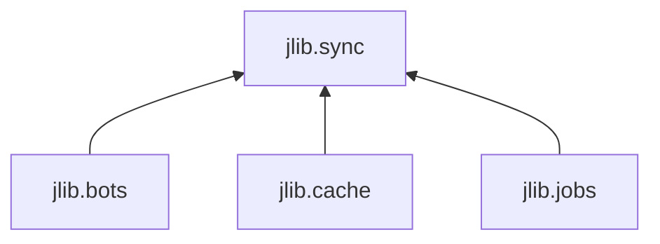
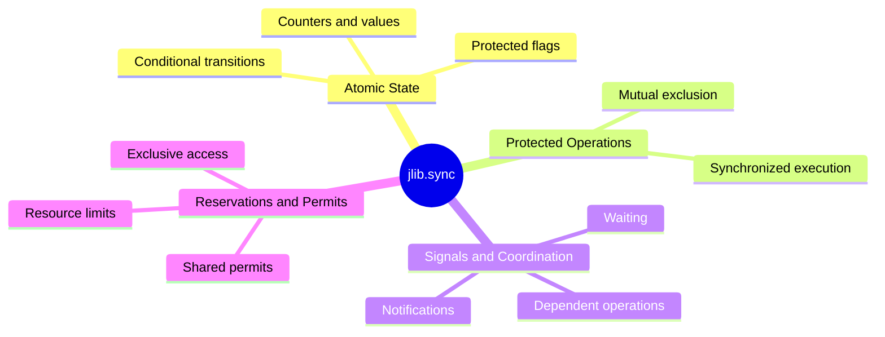

`jlib.sync` provides reusable primitives for coordinating access to shared state, managing concurrent operations, and enforcing synchronization contracts between independent components.

| Concept | Fundamental question |
|---------|----------------------|
| Mutual exclusion | Who is allowed to access this resource right now? |
| Atomicity | Can this operation happen indivisibly? |
| Signaling | How does one component notify another? |
| Coordination | How do multiple components agree on when to proceed? |
| State protection | How do we prevent inconsistent shared state? |
| Resource management | How many concurrent users can access something? |

Initially exploring four families of functionality

| Functional family | Responsibility | Example |
|-------------------|----------------|---------|
| **Atomic state** | Protected flags, counters, values, and conditional state transitions. | Change a reservation from `AVAILABLE` to `RESERVED` only if it is still available. |
| **Protected operations** | Reusable mechanisms for executing operations under synchronization constraints. | Ensure that only one thread can modify a particular shared structure at a time. |
| **Signals and coordination** | Mechanisms for notifying, waiting, and coordinating dependent operations. | Several workers wait until initialization has completed. |
| **Reservations and permits** | Controlled acquisition and release of access rights to resources. | A resource may be reserved by one participant, or may allow a fixed number of simultaneous participants. |

Domain 1 — Threads within a process

Multiple threads share the same Python objects and coordinate through threading primitives.

This is where I'd start jlib.sync.

A single AtomicCounter instance can safely serve multiple threads when all access goes through its synchronized methods.

Domain 2 — Multiple processes

Processes ordinarily have separate memory spaces. A regular threading.Lock cannot coordinate independent copies of an object across processes.

Python's multiprocessing module provides primitives for process-shared synchronization, provided the processes actually share the relevant synchronization resources.

Domain 3 — Asynchronous tasks

Multiple coroutines may interleave execution within an event loop.

asyncio.Lock coordinates tasks cooperatively, rather than blocking operating-system threads in the same way as threading.Lock.

Async coordination deserves its own interface because acquiring and waiting involve await.

Domain 4 — Distributed systems

Independent machines coordinate through networked services or protocols.

A local lock has no authority over another machine. Distributed coordination typically requires shared infrastructure and explicit handling of failures, leases, and stale participants.